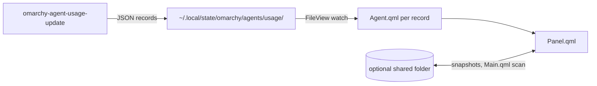

<p align="center">
  <picture>
    <source media="(prefers-color-scheme: dark)" srcset="assets/brand/wordmark-dark.svg">
    
  </picture>
</p>

<p align="center"><strong>Usage, limits and pace for every AI coding subscription, in one Omarchy bar panel.</strong></p>

> Logo is a proposal pending owner sign-off. Screenshot: TODO, a real capture of the panel (roadmap U3); the current `preview.png` is only a bar crop.

`lukedaduke.agents` is a personal fork of the stock `omarchy.agents` widget with extra providers (Claude, Codex, Fireworks, Cursor, Devin and others listed in `manifest.json`). It is a renderer: it reads usage records written by `omarchy-agent-usage-update` and ships no collectors.

## Install

```bash
omarchy plugin add https://github.com/duketopceo/omarchy-agents
omarchy plugin enable lukedaduke.agents
```

Requires `omarchy-agent-usage-update` in `~/.local/bin/` (ships with Omarchy). If it is missing the panel shows a "Setup required" message. `omarchy-launch-tui` / `omarchy-agent` are optional, for the launch and login buttons.

## What the panel shows

- Hero row: provider, plan and spend status
- A provider switch when more than one agent has data
- Limit meter with pace, and reset timer
- Prepaid balance and credit ledger
- Tokens by day and by model, with tooltips

With no enabled agents the widget hides itself from the bar, unless the helper is missing.

## How it works



## Sync (optional)

Set `syncMode` to `On` and `syncDir` to a folder shared between machines (Syncthing, Dropbox, rsync). Each machine writes `<hostname>.json` (override with `syncDeviceId` / `syncFileName`) and merges the snapshots it finds. Snapshots over 1 MiB, symlinks and non-regular files are skipped.

## Status

Known state: per the repo's `AGENTS.md`, the bar currently shows usage from Omarchy's stock `akitaonrails.ai-usagebar`, not this widget. See [ROADMAP.md](ROADMAP.md), [DESIGN.md](DESIGN.md), and the [landscape note](docs/research/2026-10-11-landscape.md).

## Contributing

This repo is the published subtree of [`duketopceo/omarchy-plugins`](https://github.com/duketopceo/omarchy-plugins) (`plugins/lukedaduke.agents/`). Make changes there; direct commits here are overwritten on the next publish.

## Remove

```bash
omarchy plugin remove lukedaduke.agents
```

## License

MIT
